# EDA Data and Plots

This note collects the current data summaries and plots from the two notebooks. All numbers come from saved local results. Matches were accepted by automated rules; acceptance does not mean they have been checked manually.

## 1. Data scope and counts

The study covers **13 municipalities**, including Boston and nearby communities. Road records are from 2022, crashes cover **2023–2025**, and images were captured **before January 1, 2023**.

| Data | Count | What the count means |
| --- | ---: | --- |
| Original road records | 55,143 | Each record represents a road segment, not an entire street |
| Road segments passing data checks | 54,647 | The road set used for imagery coverage analysis |
| Crash records in the source data | 73,207 | Includes records outside the study's audit area |
| Crash records within the audit area | 47,084 | Either the reported municipality or the municipality containing the crash coordinates is in the study |
| Crash records eligible for matching | 22,202 | Passed location, non-intersection, and other preparation checks |
| Unique image metadata records | 1,173,713 | Image IDs, locations, capture dates, and related information—not downloaded photographs |

### Crash data checks

| Result | Crash records |
| --- | ---: |
| Eligible for matching | 22,202 |
| Intersection crashes | 17,212 |
| Unknown junction classification | 2,916 |
| Invalid location geometry | 2,724 |
| Other junction classifications pending review | 1,808 |
| Outside the study boundary | 222 |
| Total within the audit area | 47,084 |

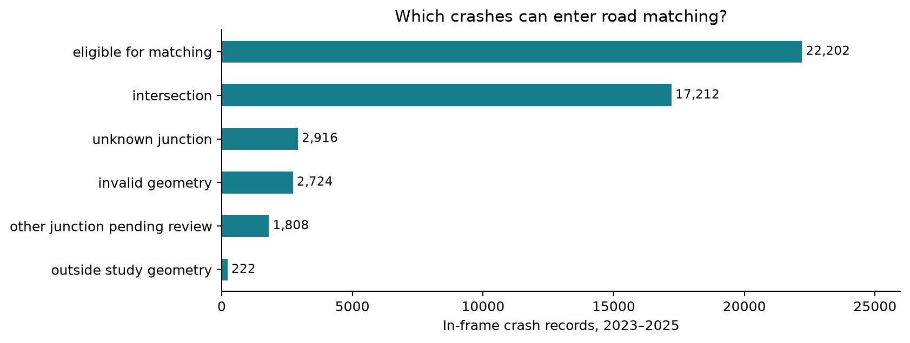

The plot shows which crashes enter road matching and why the remaining records do not.

### Missing road attributes

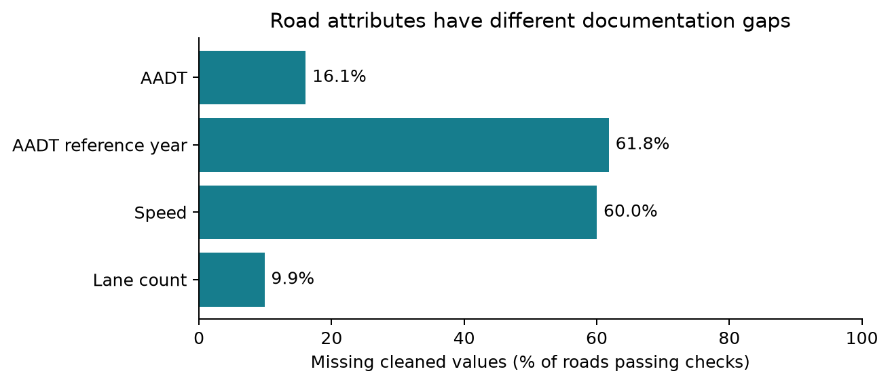

Some roads lack traffic volume, speed, or lane information. Among roads passing checks, **24,993 segments** have usable traffic-volume values but no usable measurement year. These values cannot automatically be treated as measurements of 2022 traffic.

## 2. Current matching rules

For each image or crash location, the notebook searches for candidate roads within **50 meters**, then applies these rules:

- The nearest road must be within **20 meters**.
- If there is a second candidate, it must be **more than 5 meters farther away** than the nearest road.
- For crashes, road names must also agree after spelling formats and abbreviations are standardized. Images have no road-name check.

Below, “with imagery” means a road has an image match accepted under these rules. “With a crash match” means it has at least one accepted crash assignment.

## 3. Imagery coverage

Image searches are complete around all **54,647 eligible road segments**, but only some have accepted image matches.

| Result | Road segments | Share |
| --- | ---: | ---: |
| With matched imagery | 14,004 | 25.6% |
| Without an accepted image match | 40,643 | 74.4% |
| Total | 54,647 | 100.0% |

No accepted match does not prove that Mapillary has no photograph of that location. Distance or competing nearby roads can also prevent acceptance.

### Coverage by municipality and road location

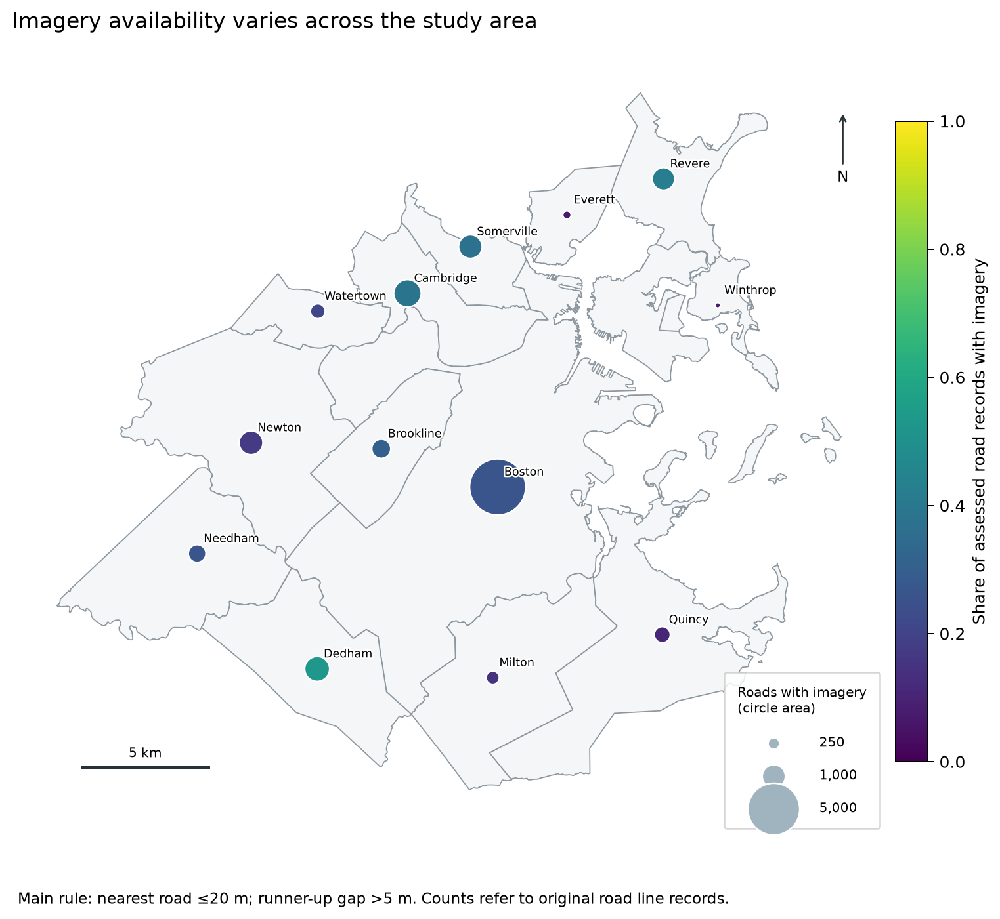

Circle size shows the number of roads with imagery; color shows the coverage percentage. Coverage varies considerably: **53.0% in Dedham** versus **7.1% in Winthrop**.

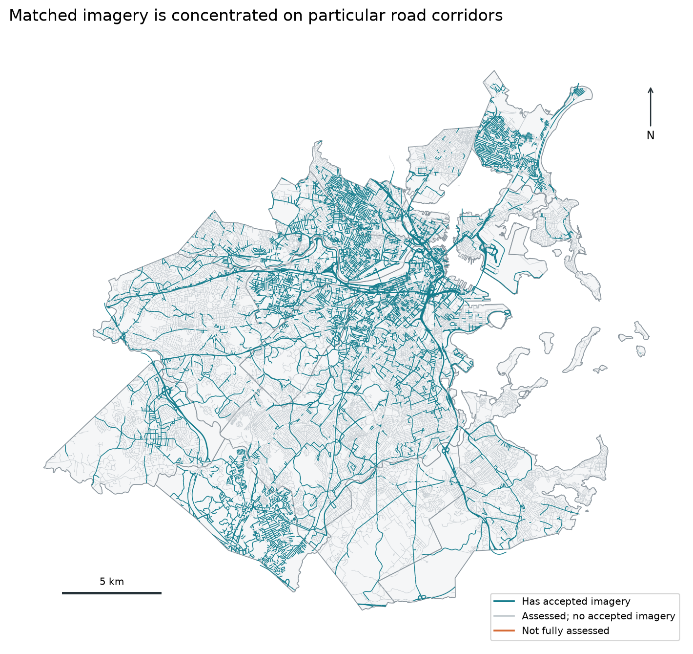

This map shows the roads with accepted image matches and the roads without them.

### Road type and traffic volume

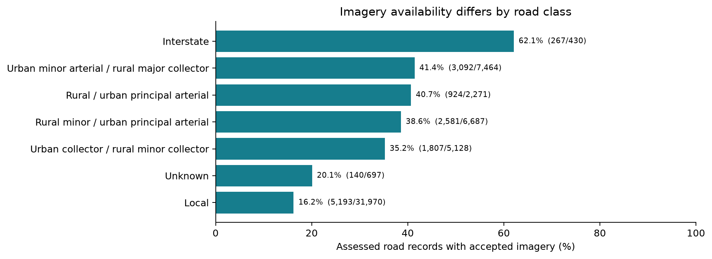

Imagery coverage also differs across road types.

| Road group | Median available daily traffic volume |
| --- | ---: |
| With matched imagery | 6,956 |
| Without an accepted image match | 1,154 |

Traffic volume here means annual average daily traffic. These medians use only roads with available values and do not account for differences in municipality or road type. Roads with imagery have a higher median traffic volume in this dataset.

### Image capture years

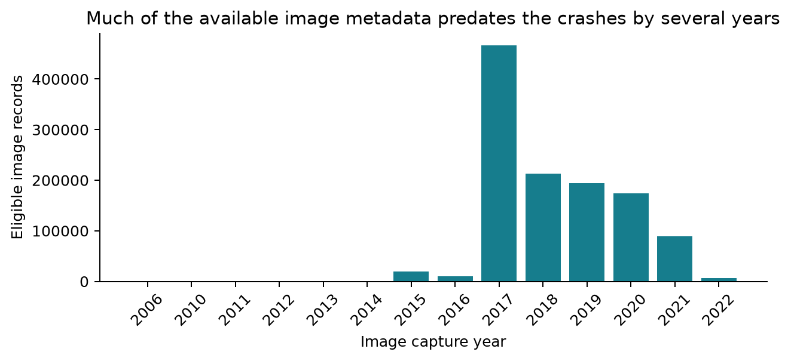

Images are concentrated in **2017–2020**. This plot describes eligible image records, not just the representative image selected for each road.

## 4. Crash matching results

Of the **22,202 crashes** entering matching, **12,714 (57.3%)** were accepted under the main rules.

| Matching result | Crash records |
| --- | ---: |
| Accepted | 12,714 |
| Multiple nearby roads with similar distances | 5,633 |
| Missing road name | 2,127 |
| Road names disagree | 1,715 |
| Nearest road beyond the accepted distance | 10 |
| No candidate road within 50 meters | 3 |
| Total | 22,202 |

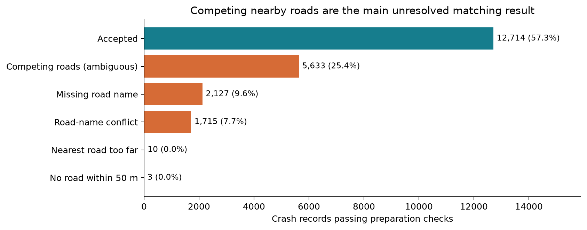

The largest unresolved group has multiple nearby candidate roads. Candidates include roads just outside the study area, so **12,714 is not the crash count within the final comparison sample**.

### Where matches are accepted or uncertain

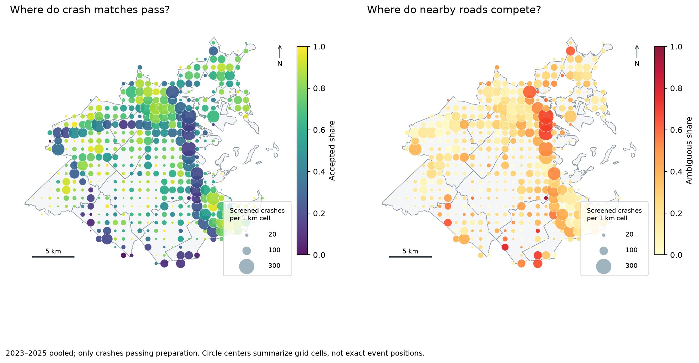

Each circle summarizes a 1-kilometer by 1-kilometer area. Circle size represents crash counts; color shows the accepted or ambiguous share. These are not measurements of risk per traveler.

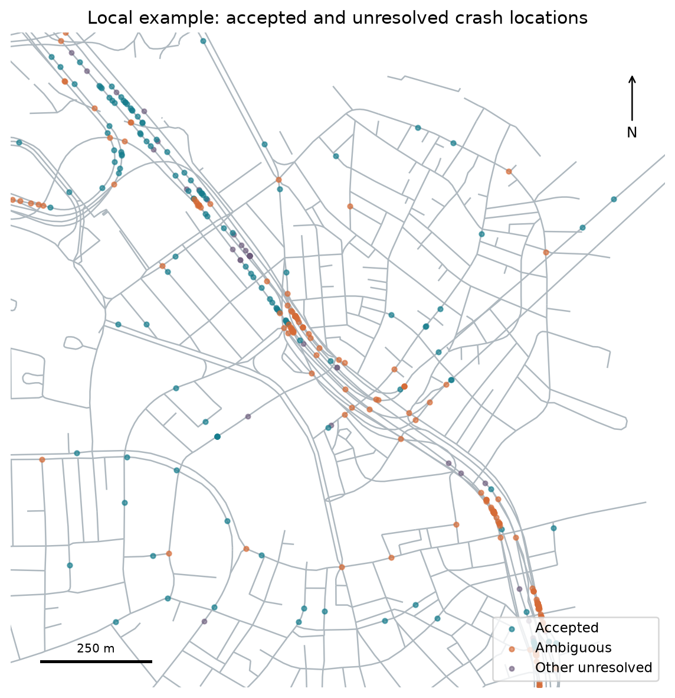

The local example shows crash points and nearby roads. A point close to a road is not necessarily a clear match, and overlapping points can hide multiple crash records.

## 5. Matching distance and uncertainty exclusions

### Comparing distance settings

| Accepted distance | Roads with imagery | Imagery coverage | Accepted crash matches |
| --- | ---: | ---: | ---: |
| 10 meters | 13,923 | 25.48% | 12,683 |
| 20 meters | 14,004 | 25.63% | 12,714 |
| 30 meters | 14,034 | 25.68% | 12,715 |

All three settings keep the 50-meter search radius and the requirement that the second road be more than 5 meters farther away. Increasing the accepted distance from 10 to 30 meters adds only **111 roads with imagery** and **32 accepted crash matches**.

### Roads excluded because crash assignments remain uncertain

If a crash remains unresolved under any tested distance setting, all candidate study roads within 50 meters are excluded from the common comparison set. This avoids automatically treating those roads as having no crash matches.

| Result | Road segments | Share of roads passing checks |
| --- | ---: | ---: |
| Excluded because of uncertain crash assignments | 14,067 | 25.7% |
| Remaining after exclusions | 40,580 | 74.3% |

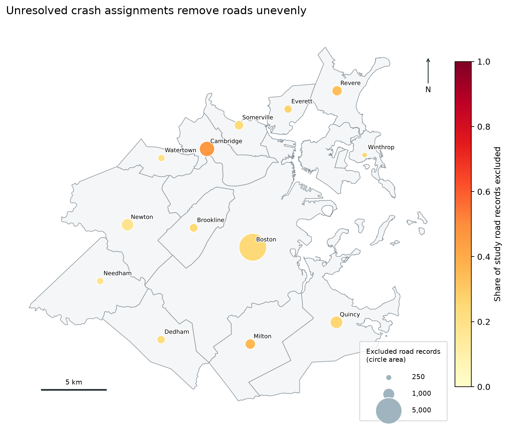

Circle size shows the number of excluded roads; color shows the excluded share within each municipality. The **40,580 remaining roads include roads with and without imagery**.

## 6. Imagery coverage by crash-match status

This comparison uses the **40,580 remaining roads** with completed image searches. Crash groups use the main 20-meter matching setting.

| Crash-match status | With imagery | Without an accepted image match | Total roads | Imagery coverage |
| --- | ---: | ---: | ---: | ---: |
| At least one accepted crash match | 1,492 | 2,295 | 3,787 | 39.4% |
| No accepted crash match | 7,429 | 29,364 | 36,793 | 20.2% |
| Total | 8,921 | 31,659 | 40,580 | 22.0% |

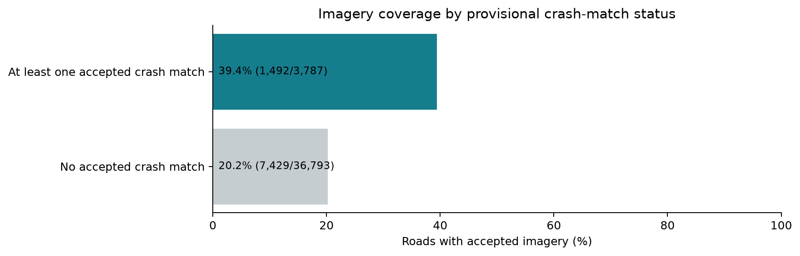

Roads with accepted crash matches have roughly twice the imagery coverage of roads without them.

Among the **8,921 roads with imagery**, **1,492 (16.7%)** have accepted crash matches and **7,429 (83.3%)** have none. No accepted crash match does not confirm that a road had no crashes.

## 7. Mapillary detection results

One representative image was selected for each of the **8,921 roads** above. The Mapillary API returned detection IDs and category labels. **No photographs were downloaded, and no pixel proportions were calculated.**

| Query result | Roads / representative images | Share |
| --- | ---: | ---: |
| Successful queries | 8,921 | 100.0% |
| Successful, with detections | 8,341 | 93.5% |
| Successful, without detections | 580 | 6.5% |
| Queries still failing after retries | 0 | 0.0% |

The responses contain **316 distinct labels**. Successful response bodies total approximately **104 MB** and are saved locally.

### Detection overview

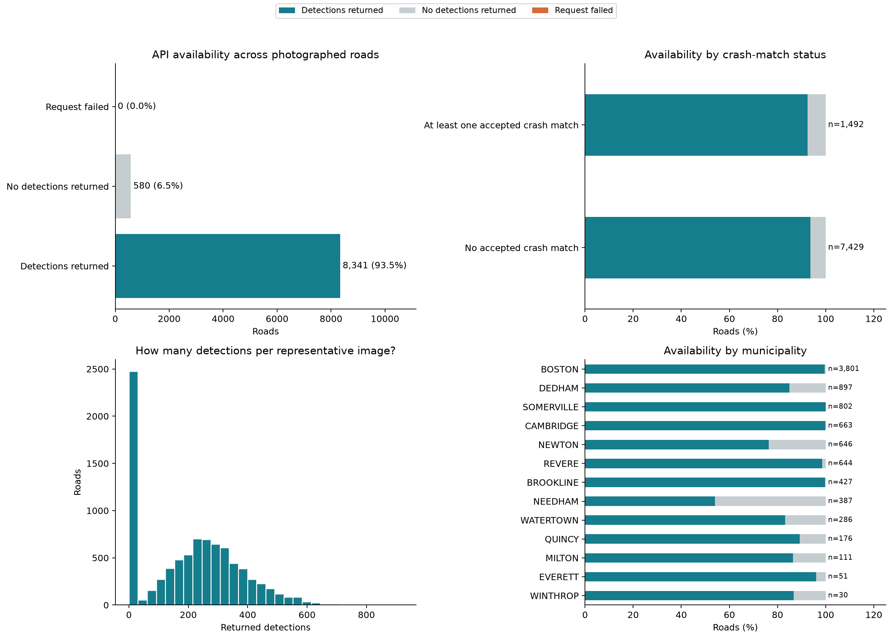

The overview shows query outcomes, comparisons between crash groups, the number of detections per image, and results by municipality.

| Crash-match status | Roads queried | With detections | Share with detections |
| --- | ---: | ---: | ---: |
| At least one accepted crash match | 1,492 | 1,379 | 92.4% |
| No accepted crash match | 7,429 | 6,962 | 93.7% |

The two crash groups have similar detection-return rates, while differences across municipalities are more noticeable. These percentages describe roads with representative images, not all roads in each municipality.

### An actual response

Image `299245798408243`, matched to road segment `2022:2197`, returned:

```json
{
  "data": [
    {"id": "299937998339023", "value": "object--support--utility-pole"},
    {"id": "300657121600444", "value": "warning--slippery-road-surface--g2"}
  ]
}
```

These records describe a utility pole and a slippery-road warning sign. The labels belong to the image and are linked to the road through its accepted image match.

### Most common visual features

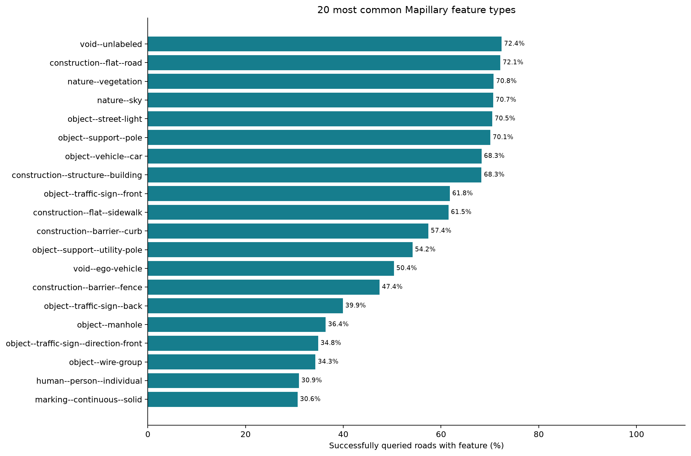

**Feature frequency = roads whose representative image returned the label / 8,921 successfully queried roads.** Each road counts once per label, even if its image contains multiple detections of that type. Successful queries with no detections remain in the denominator.

For example, vegetation was returned for 6,313 roads, giving **70.8%**. This is not the percentage of image pixels covered by vegetation.

| Plain-language name | API label | Roads | Share |
| --- | --- | ---: | ---: |
| Unclassified regions | `void--unlabeled` | 6,459 | 72.4% |
| Road | `construction--flat--road` | 6,435 | 72.1% |
| Vegetation | `nature--vegetation` | 6,313 | 70.8% |
| Sky | `nature--sky` | 6,305 | 70.7% |
| Streetlight | `object--street-light` | 6,288 | 70.5% |
| Pole | `object--support--pole` | 6,252 | 70.1% |
| Car | `object--vehicle--car` | 6,092 | 68.3% |
| Building | `construction--structure--building` | 6,091 | 68.3% |
| Traffic sign, front | `object--traffic-sign--front` | 5,513 | 61.8% |
| Sidewalk | `construction--flat--sidewalk` | 5,488 | 61.5% |
| Curb | `construction--barrier--curb` | 5,121 | 57.4% |
| Utility pole | `object--support--utility-pole` | 4,832 | 54.2% |

### Feature distributions by crash group and road type

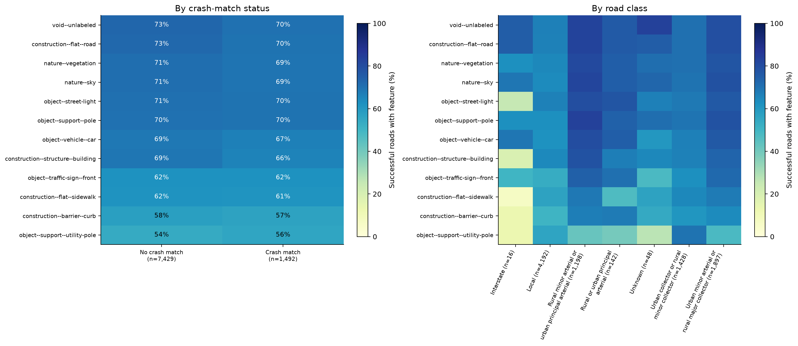

This plot uses the 12 most common labels. Each cell uses the successfully queried roads within that group as its denominator. Darker colors indicate a higher share of representative images returning the label. These are descriptive comparisons, not evidence that a feature causes or predicts crashes.

The detection analysis queries only one representative image per road. A missing label does not establish that the object is absent from the entire segment.

## Data and plot sources

- [Notebook 01: Data acquisition and preprocessing](01_raw_data_preprocessing.ipynb)
- [Notebook 02: Imagery coverage, crash matching, and detection analysis](02_imagery_crash_matching.ipynb)
- [Imagery coverage by crash-match status](data/processed/imagery_coverage_by_crash_status.csv)
- [Road-level API query results](data/processed/mapillary_detection_audit.csv)
- [Road counts and coverage for all 316 labels](data/processed/mapillary_feature_coverage.csv)
